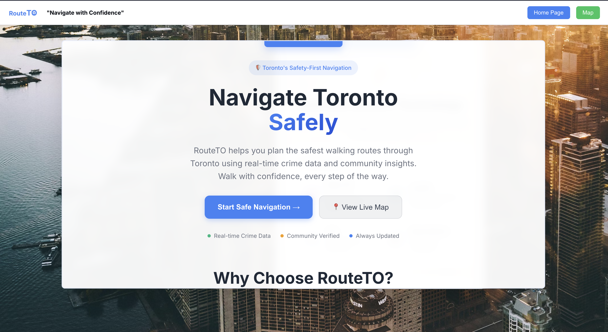
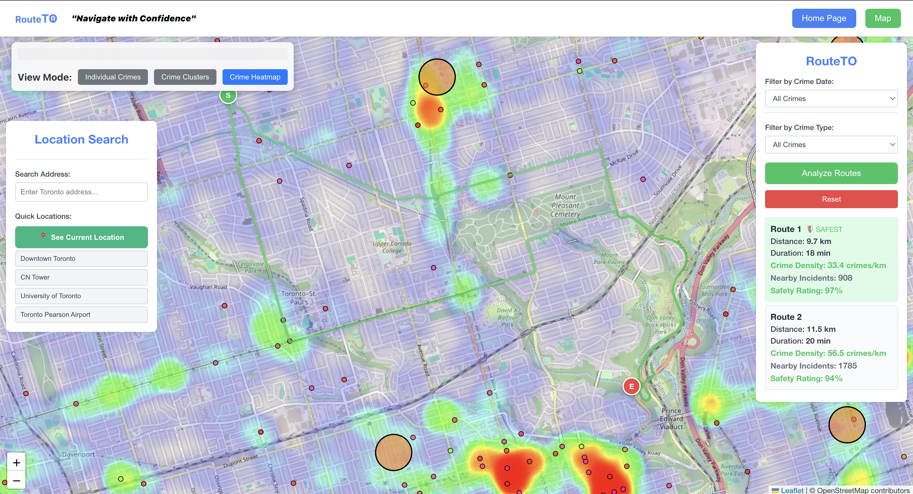
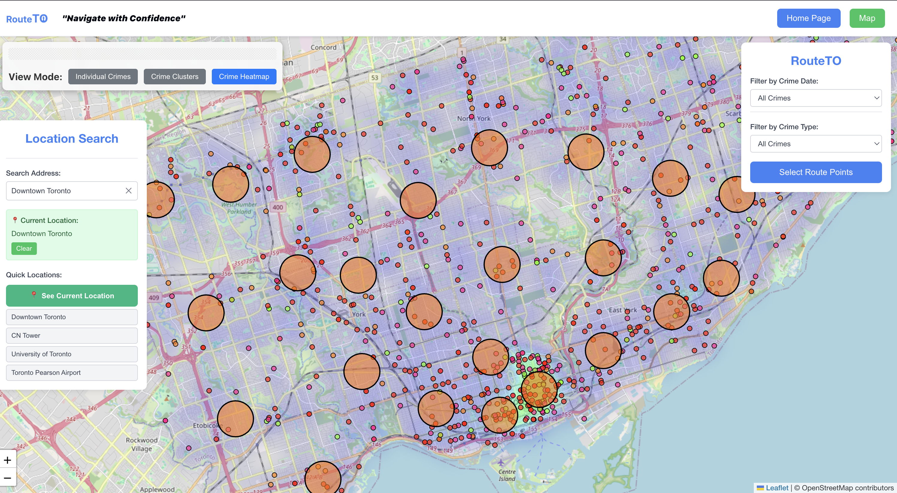

# RouteTO
** Crime-Aware Dynamic Route Planner for Toronto
** Ignition Hacks V5 Winner - 3rd Place 

  
  

## Features

### Interactive Crime Mapping
- **Real-time Crime Visualization**: Display Toronto crime incidents on an interactive map
- **Multiple View Modes**: Switch between individual markers, crime clusters, and heatmap density views
- **Crime Type Filtering**: Filter by specific crime categories (Assault, Auto Theft, Break and Enter, Robbery, Theft Over)
- **Temporal Filtering**: View crimes from specific time periods (Last 14 Days, Month, 6 Months, Year)
- **Dynamic Loading**: Crime data loads based on current map viewport for optimal performance

### Smart Route Analysis
- **Safety-First Routing**: Analyze multiple route options and identify the safest path
- **Crime Risk Assessment**: Calculate crime density and safety ratings for each route
- **Visual Route Comparison**: Color-coded routes (Green: Low Crime, Yellow: Medium, Red: High)
- **Detailed Route Metrics**: Distance, duration, crime density, and nearby incident counts

### Location Services
- **Address Search**: Search for Toronto addresses using OpenStreetMap geocoding
- **Current Location**: Get user's current location using browser geolocation API
- **Quick Locations**: Fast navigation to popular Toronto destinations (CN Tower, Downtown, Airport)
- **Smart Positioning**: Automatically position map view under control panels

### User Interface
- **Responsive Design**: Optimized for desktop and mobile devices
- **Draggable Controls**: Movable view mode controls for customized layout
- **Navigation Bar**: Clean top navigation with Home and Map sections
- **Filter Indicators**: Visual feedback showing active crime type and date filters

  
  
  

### CSV Download Process

Due to GitHub's 100MB file size limit, the crime data CSV must be downloaded separately:

1. **Visit Toronto Open Data Portal**:
   - Navigate to: https://open.toronto.ca/dataset/major-crime-indicators/
   - Look for "Major Crime Indicators" dataset

2. **Download the CSV File**:
   - Click on the CSV download link (typically ~200-500MB)
   - File format: `Major_Crime_Indicators_Open_Data_[ID].csv`

3. **Place in Data Directory**:
   ```
   RouteTO/
   └── data/
       └── Major_Crime_Indicators_Open_Data_-3805566126367379926.csv
   ```

4. **Alternative Data Sources**:
   - Any Toronto crime CSV with required columns will work
   - Minimum required fields: `LAT_WGS84`, `LONG_WGS84`, `MCI_CATEGORY`, `OCC_DATE`

### Performance Features
- **Async Processing**: Non-blocking I/O for concurrent requests
- **Response Caching**: HTTP cache headers for map data
- **Data Pagination**: Configurable result limits
- **Bounding Box Optimization**: Efficient spatial queries

### Data Processing Pipeline
1. **Request Validation**: Pydantic models ensure data integrity
2. **Spatial Filtering**: Pandas operations for bounding box queries
3. **Crime Analysis**: NumPy calculations for risk assessment
4. **Route Optimization**: OSRM integration for path finding
5. **Response Formatting**: GeoJSON serialization for frontend

## Installation & Setup

### Prerequisites
- **Node.js** 16+ and npm
- **Python** 3.8+ and pip
- **Git** for version control

### Frontend Setup
```bash
cd frontend
npm install
npm run dev
```

### Backend Setup
```bash
cd backend
pip install -r requirements.txt
python main.py
```

### Data Setup
1. Download Toronto crime CSV (see Data Setup section above)
2. Place in `data/` directory
3. Backend will automatically load and process the data

## Future Enhancements

### Planned Features
- **Real-time Crime Alerts**: Push notifications for nearby incidents
- **Historical Trends**: Long-term crime pattern analysis
- **Community Integration**: User-submitted safety reports
- **Mobile App**: Native iOS/Android applications
- **Advanced Routing**: Multi-modal transportation options

### Technical Improvements
- **Machine Learning**: Predictive crime modeling
- **WebSocket Support**: Real-time data updates
- **Offline Capabilities**: Progressive Web App features
- **Advanced Analytics**: Crime trend visualization

Links  
-----

- Devpost Submission: https://devpost.com/software/rainbolt-ai  

---

License  
-------

Proprietary. Built for Hack the Valley X 2025.
